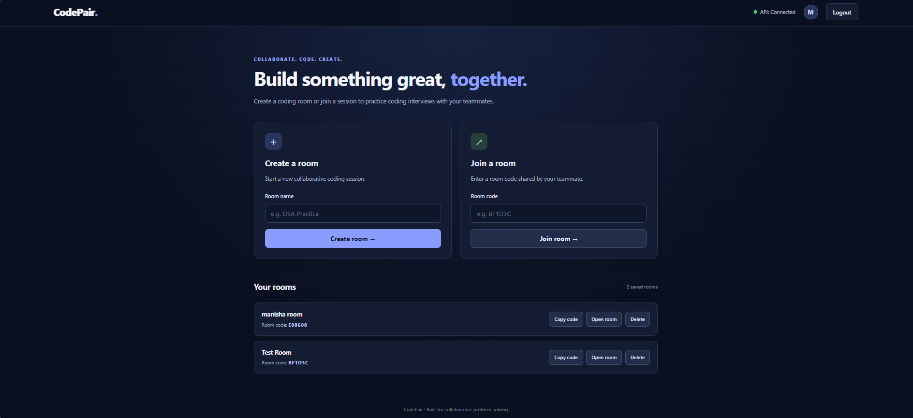
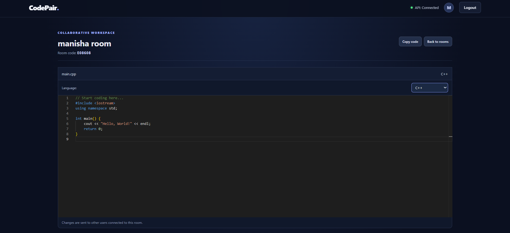
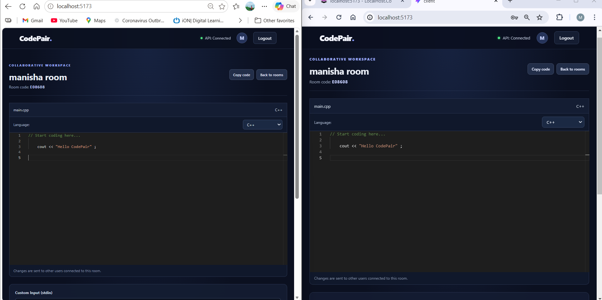
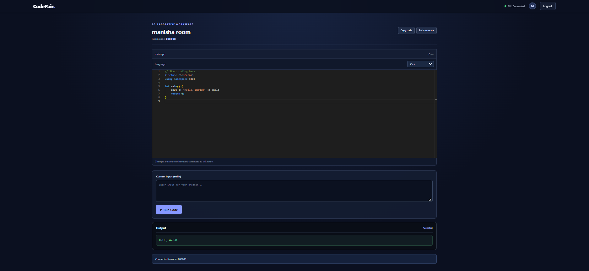

# CodePair - Real-Time Collaborative Code Editor

CodePair is a web-based collaborative coding platform where users can create coding rooms, invite teammates using a room code, write code together in real time, and execute programs in supported programming languages.

## Features

- Create and join coding rooms using unique room codes
- Real-time code collaboration with Socket.IO
- Synchronize programming languages between collaborators
- Write code in the Monaco Editor
- Run code in supported languages: C++, Java, Python, and JavaScript
- Provide custom standard input (stdin)
- View execution output and errors
- Retrieve saved rooms using PostgreSQL

## Screenshots

### Home Page


### Code Editor


### Live Collaboration


### Code Execution Output


## Tech Stack

- **Frontend:** React, Vite, CSS, Monaco Editor
- **Backend:** Node.js, Express.js
- **Real-Time Communication:** Socket.IO
- **Database:** PostgreSQL
- **Code Execution:** Judge0 API

## Project Structure

```text
CodePair/
├── client/       # React frontend
├── server/       # Node.js backend
├── screenshots/  # Project screenshots
├── .gitignore
└── README.md
```

## Prerequisites

- Node.js and npm
- PostgreSQL
- Code-execution API configuration, if required by the backend

## Getting Started

### 1. Clone the Repository

```bash
git clone YOUR_GITHUB_REPOSITORY_URL
cd CodePair
```

Replace `YOUR_GITHUB_REPOSITORY_URL` with your GitHub repository URL.

### 2. Set Up the Backend

```bash
cd server
npm install
```

Create a `server/.env` file and configure the environment variables required by your backend, including database and code-execution API settings.

Never commit `.env` files, API keys, or database passwords.

Start the backend:

```bash
node index.js
```

### 3. Set Up the Frontend

Open another terminal from the project root:

```bash
cd client
npm install
npm run dev
```

Open the local URL shown by Vite, usually `http://localhost:5173/`.

Keep both the frontend and backend running while using the application.

## How to Use

1. Open CodePair in your browser.
2. Create a coding room or join one using its room code.
3. Open the same room in another browser window to test collaboration.
4. Edit code and check whether changes appear in the other window.
5. Change the programming language and verify synchronization.
6. Enter custom input if required and click **Run Code**.
7. Check the execution output or reported errors.

## Future Improvements

- User authentication and personalized workspaces
- Improved room access controls
- More robust collaboration and connection recovery
- Cloud deployment and production monitoring

## Project Goal

CodePair aims to make collaborative programming practice easier by combining real-time code sharing, language synchronization, and program execution in one workspace.
